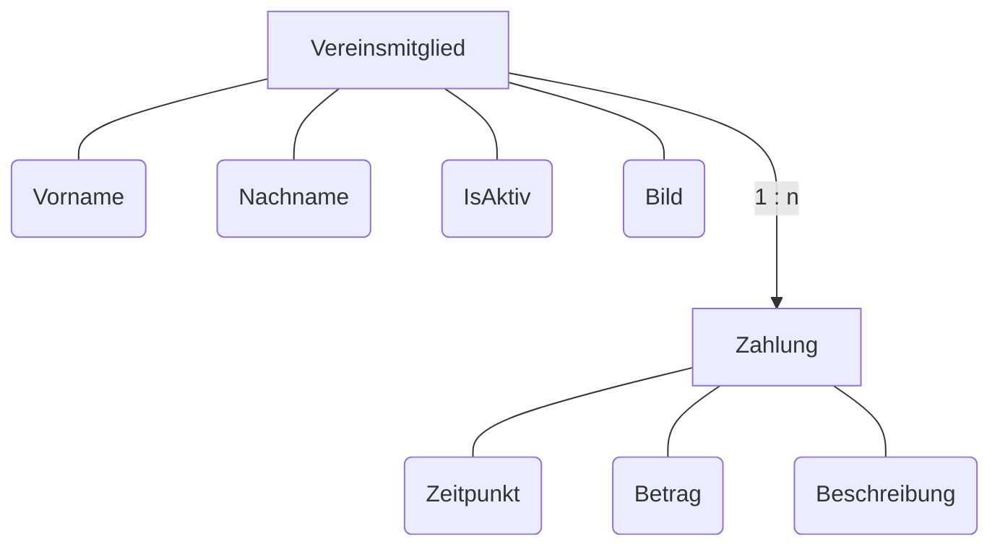

# Sparverein

## Thomas Korn

http://localhost:5152

## Projektbeschreibung

Die Anwendung verwaltet Mitglieder und Geldflüsse eines Sparvereins

### Hauptfunktionen

- Anlegen, Bearbeiten und Löschen von Vereinsmitgliedern
- Anlegen, Bearbeiten und Löschen von Zahlungen
- Suche und Filterung von Zalungen
- Statistiken von Zahlungen

## Technologien

| Technologie                  | Einsatzgebiet       |
| ---------------------------- | ------------------- |
| C#                           | Programmlogik       |
| ASP.NET Core MVC             | Webanwendung        |
| Entity Framework Core        | Datenbankzugriff    |
| SQL Server                   | Datenbank           |
| SQL Server Management Studio | Datenbankverwaltung |
| Razor Views                  | Benutzeroberfläche  |
| Bootstrap                    | Layout und Styling  |

## Projektstruktur (MVC)

### Model

Enthält die Datenmodelle der Anwendung

- Zahlung
- Vereinsmitglied

### View

Enthält CSHTML-Dateien für die Benutzeroberfläche

- Zahlungen 
    - Liste (**Startseite**)
    - Details
    - Bearbeiten
- Vereinsmitglieder 
    - Liste
    - Details
    - Bearbeiten
- Statistiken

### Controller

Verarbeitet Benutzereingaben und steuert die Anwendung

- ZahlungController
- VereinsmitgliedController
- StatistikController

### DbContext

Verbindet die Anwendung mit der Datenbank und verwaltet die Entitäten

## ER-Diagramm

